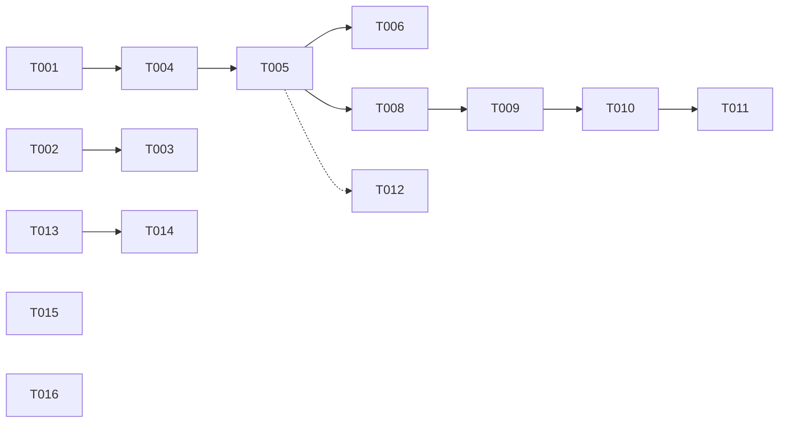

# Plan (order and timing)
Goals: [goals.md](goals.md). Design, risks, decisions: [blueprint.md](blueprint.md). Task state: [TRACKER.md](TRACKER.md#execution-tracker). History: [docs/PLAN.md](docs/PLAN.md).

## Milestones
Done: M0 foundation, M1 walking skeleton, M2 MVP (forecaster, web app, snapshot).

| M | Goal | Tasks | Exit criteria (testable) | P50 / P90 h (+20% buffer on P90) | Risks | Demo |
|---|---|---|---|---|---|---|
| M3 Safe | nothing irreplaceable or unlawful exposed | T-001…T-004 | restore of ledgers verified; D-005 recorded; publish refuses a dirty tree | 10 / 15 (18) | R-02 R-03 R-04 | restore + refused publish |
| M4 Unattended | record grows without attention | T-005…T-008 | 10 consecutive trading days recorded; failure is visible | 14 / 21 (25) | R-05 R-06 | run log |
| M5 Evidence | judge the model | T-009…T-012 | KR1.1 met; report with uncertainty | 11 / 17 (20) | R-01 | 2027-03-31 review |
| M6 Upkeep | maintainable | T-013…T-016 | CI green; app.js split; fresh install works | 14 / 24 (29) | R-07 | CI run |

## Dates
M3 by 2026-12-05 · M4 by 2026-12-19 · M5 review 2027-01-31 (interim), 2027-03-31 (final) · M6 any time after M4.
Capacity `[A]` A-04: ~5 h/week → M3 alone is 18 h against 1 week to 2026-12-05, and M3+M4 are 43 h ≈ 9 weeks. The dates hold **only if** assistant sessions do the build tasks and the owner does T-001, T-002, T-007 (4 h) in time.

## Critical path

Parallel lanes: safety (T-001–T-003) · automation (T-004–T-008) · upkeep (T-013–T-016). Calendar-bound: T-009 cannot be accelerated.

## Release, rollback, comms
Release = commit on `main` with tests green, then publish. Rollback: revert commit and republish, or restore Vercel's previous deployment. Comms: change line in the tracker.

## Rules
Ready: files, command and pass/fail check named. Done: tests pass **and** behaviour observed; docs regenerated; BUGS/LOG updated.
Change control: a milestone slipping > 20% of its duration → decision record in blueprint and replan. Budget ₹0.

## Red-team pass
| Gap | Fix |
|---|---|
| 60 dates of overlapping 5-day outcomes give a wide AUC interval, so K-1 can fire or pass by luck | T-010 reports the interval; S-1/K-1 verdicts quote it |
| 20-day model has no forward target | not judged before 2027-06: too few separate periods |
| record has holes if the Mac sleeps | T-007, T-008 |
| daily task publishes half-done work | T-004 moved into M3 |
| dates exceed stated capacity | dependency on assistant sessions made explicit above |

## Production checklist
security ◐ (no login by design; R-03 accepted, D-005) · tests ✔ · observability ✔ run log and missed days · rollback ✔ (redeploy previous) · cost ✔ A-03 · docs ✔

## Next 5
T-001 → T-007 → T-012 → T-014 → T-009 (calendar)
