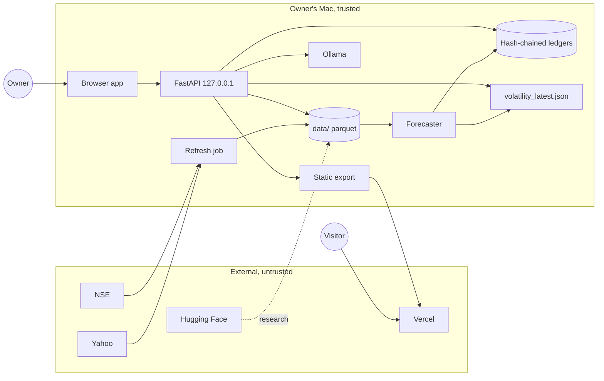
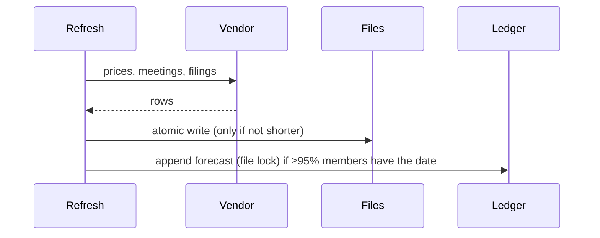
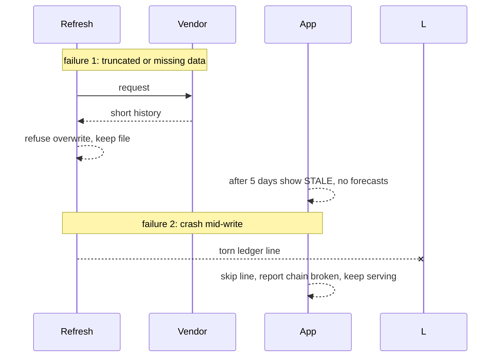

# Blueprint (how)
Goals: [goals.md](goals.md). Module list: [nifty_analyser/README.md](nifty_analyser/README.md). Routes: [docs/API.md](docs/API.md). Pipelines: [docs/ARCHITECTURE.md](docs/ARCHITECTURE.md). Run: [docs/OPERATIONS.md](docs/OPERATIONS.md). Protections: [docs/SECURITY.md](docs/SECURITY.md).

## 1. Scope boundary
In: Nifty 50 end-of-day data, volatility forecasts, filings search and guarded answers, local web app, read-only public snapshot. Out: trading, intraday serving, accounts.

## 2. Architecture

| Component (L3) | Responsibility | Code |
|---|---|---|
| Ingest | point-in-time rows; drop unfinished bars; never shrink files | `data/` |
| Features, models | volatility terms; linear + boosted blend; ranges | `features/`, `models/` |
| Forecaster | train on realised outcomes, record, grade | `ops/vol_forecast.py` |
| Web | read-only JSON, protected refresh | `ops/web.py`, `web/` |
| API v3 | direction (mostly abstains), evidence, explain, kill switch | `ops/api.py` |
| Export | JSON snapshot plus browser shim | `scripts/export_static.py` |

## 3. Stack
| Choice | Why | Rejected |
|---|---|---|
| Python 3.12, pandas, LightGBM, scikit-learn | existing, fits tabular data | deep models: no gain measured |
| Parquet + JSON lines files | one user, no server to run | database: no concurrent users |
| FastAPI on localhost | typed, small | desktop shell: more upkeep |
| Plain HTML/CSS/JS | no build step, strict CSP | React: tooling cost for one page app |
| Vercel static | no server to attack | hosting the API: no login |
| Ollama local models | filings stay on device | hosted LLM: cost, data leaves |

## 4. Data
```mermaid
erDiagram
  INSTRUMENT ||--o{ BAR : has
  INSTRUMENT ||--o{ FILING : publishes
  INSTRUMENT ||--o{ MEETING : announces
  BAR }o--o{ FORECAST : informs
  FORECAST ||--|| LEDGER_ENTRY : recorded_in
  BAR { string instrument_id; datetime event_time; datetime available_time; float close; string quality_flag }
  LEDGER_ENTRY { int seq; string date; int horizon_days; json forecasts; string prev_hash; string hash }
```
Retention: keep everything; raw is re-downloadable except ledgers (irreplaceable, `data/processed/*.jsonl`). Migrations: ledger payload is versioned by `model` tag; new fields must be optional.

## 5. Interfaces
Routes in [docs/API.md](docs/API.md). Errors: 404 unknown id, 422 bad input, 403 foreign refresh, 409 refresh running; pages show status `OK/STALE/HALTED/NO_DATA`. Versioning: `/v3/*` contract; `/api/*` is private to the app. Idempotency: a forecast is recorded once per (date, horizon).

## 6. Flows



## 7. Non-functional targets
| ID | Target | Now |
|---|---|---|
| N1 | page data p95 < 200 ms warm | `[F]` ≤70 ms; record 286 ms on first call after change |
| N2 | first System page < 1 s after start | `[F]` 0.23 s |
| N3 | refresh finishes < 15 min | `[A]` A-02 |
| N4 | data age shown; forecasts withheld > 5 days | `[F]` |
| N5 | ledger RPO ≤ 7 days, RTO ≤ 1 h | `[R]` no backup yet (R-02) |
| N6 | running cost ₹0/month (free tiers) | `[A]` A-03 |
| N7 | WCAG 2.1 AA contrast, keyboard use | `[F]` contrast tested; no screen-reader test |

## 8. Security and privacy
| STRIDE | Threat | Mitigation | Gap |
|---|---|---|---|
| Spoofing | foreign site reaches localhost | host check, same-origin + custom header on refresh | no login (by design) |
| Tampering | edit history | hash chains | whole-file rewrite possible without backup |
| Repudiation | "forecast made after outcome" | timestamped chain | chain not anchored externally (T-012) |
| Info disclosure | public export leaks owner activity | stripped | licence of data (R-03) |
| DoS | malformed input | validation, fuzzed routes | none known |
| Elevation | hostile filing text | textContent, CSP, answer guardrails | guardrails check support, not truth |
Secrets: only `STM_ADMIN_TOKEN` (env) and Vercel CLI login; none in repo. PII: none stored; holdings stay in the browser.

## 9. AI components
| Use | Model | Guardrail | Budget | Eval |
|---|---|---|---|---|
| explain | `qwen3:8b` local | citations, numbers, overlap, abstain | local, no fee | `scripts/run_explain_eval.py` |
| retrieval | `mxbai-embed-large` + BM25 | time firewall | local | `reports/judged_eval.json` |
Fallback: evidence-only digest, or BM25 only.

## 10. Delivery and observability
Env: one (owner's Mac) plus static prod. CI: none `[F]` (T-006). Deploy: daily task ~19:00 runs `scripts/daily_publish.sh` on the working folder, only if it is clean and tests pass (R-04). Rollback: redeploy a previous commit's export, or Vercel's previous deployment. Observability: audit log, System page, publish live-check; no alert on failure (T-005).

## 11. Tests and layout
pytest: unit, route, point-in-time, doc-freshness, static checks; `scripts/smoke_web.py` on real data. Not covered: coverage %, load, browser automation. Layout and generated docs: [docs/README.md](docs/README.md); regenerate with `scripts/build_docs.py`.

## 12. Decisions
| ID | Decision | Options (score /5, weights: honesty .4, effort .3, risk .3) | Consequence | Revisit when |
|---|---|---|---|---|
| D-001 | forecast volatility, not direction | volatility 4.4 · direction 1.8 · rank 2.6 | no trade signal | new data type |
| D-002 | files, not a database | files 4.2 · SQLite 3.6 · Postgres 2.2 | simple; single writer locks | second user |
| D-003 | localhost app, static public copy | static 4.1 · hosted API 2.0 · none 3.9 | public copy has no Ask/refresh | login needed |
| D-004 | single `main` branch (owner's rule) | main 3.8 · feature branches 3.7 · trunk+CI 4.0 | no review gate | second contributor |
| D-005 | keep the public snapshot online (owner, 2026-11-28), against the recommendation | private 4.6 · summaries only 3.8 · as now 2.0 | terms still unread; owner accepts R-03; cannot recall what was published | any notice from a source, terms read, or wider sharing (K-3) |
Reversibility: all cheap except published data (D-005: cannot be recalled).

## 13. Risks (score = probability × impact, 1–5)
| ID | Risk | P×I | Mitigation | Owner | Trigger |
|---|---|---|---|---|---|
| R-01 | back-test flatters the model | 3×4=12 | forward grading, K-1 | owner | forward AUC < 0.60 at 30 dates |
| R-02 | ledgers lost with the Mac | 3×5=15 | weekly off-machine copy | owner | no backup 7 days |
| R-03 | Yahoo/NSE terms breached by public site | 3×4=12 | D-005 | owner | notice, or terms read |
| R-04 | half-done work auto-deployed | 1×3=3 | publish refuses a dirty tree or failing tests (T-004, done) | dev | dirty tree at 19:00 |
| R-05 | vendor changes or blocks access | 3×3=9 | caches, freshness panel | dev | 2 failed refreshes |
| R-06 | job only runs while the desktop app is open | 4×3=12 | launchd or reminder | owner | missed trading day |
| R-07 | one person knows the system | 3×3=9 | operations doc, tests | owner | — |
| R-08 | public repo has no licence file | 3×2=6 | choose one | owner | outside use |

## 14. Assumptions and open questions
| ID | Assumption | Falsify by |
|---|---|---|
| A-01 | the snapshot has outside visitors | Vercel analytics, or ask owner |
| A-02 | refresh < 15 min | time it (T-005) |
| A-03 | free tiers suffice | billing page |
| A-04 | planning inputs not supplied: one owner-developer, ~5 h/week, ₹0 budget, deadline = OKR dates | owner corrects |
| A-05 | 5 data dates a week are achievable | KR1.1 trend |
Open: Q2 backup destination (recommend: private cloud drive folder) · Q3 licence (recommend: none-reuse "All rights reserved" until decided).

## Pre-mortem (dead by 2027-05)
Laptop asleep at 19:00 so the record has holes → R-06. Disk lost → R-02. Takedown notice → R-03. Numbers read as buy signals → guardrail in goals. Forward AUC near 0.5 → K-1.
**Cheapest test of the riskiest assumption (R-01):** change nothing; record daily for 60 days.

## Glossary
AUC: chance a busy period is ranked above a calm one. Ledger: append-only hash-chained forecasts. Coverage: share of outcomes inside the predicted range.
